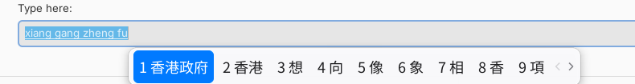

<div align="center">

# 港式拼音 · HK Pinyin for Ubuntu

**Type Hanyu Pinyin, get Hong Kong Traditional Chinese — with the feel of macOS.**

[](https://github.com/YOUR-USERNAME/hk-pinyin-ime/actions/workflows/test.yml)


<sub>Typing <code>xianggangzhengfu</code> <code>"</code> <code>dianyou</code> <code>"</code> <code>bingxiang</code> <code>,</code> <code>rq</code> <code>.</code> gives 香港政府「電郵」雪櫃，2026年10月19日。</sub>

</div>

---

## Why

Most Linux pinyin input methods output Simplified Chinese, or Taiwan-style Traditional Chinese
(軟體, 網路, 計程車). If you live or work in Hong Kong and type with pinyin, you end up fixing
every other word. **港式拼音** gives you Hong Kong output by default:

| | Typical pinyin IME | **港式拼音** |
|---|---|---|
| Characters | 爲 衛 綫 檯 | **為 衞 線 枱** |
| Vocabulary | 軟體 · 網路 · 計程車 · 冰箱 · 什麼 | **軟件 · 網絡 · 的士 · 雪櫃 · 甚麼** |
| Punctuation | “ ” ‘ ’ | **「 」 『 』 、 …… ——** |
| Dates | 2026-10-19 | **2026年10月19日 · 19/10/2026 · 下午3:05** |
| Cantonese words | — | **嘅 咗 喺 佢哋 唔該 而家** |

## What it looks like

<p align="center">
  <br>
  <br>
  <sub>A single-row candidate window in macOS light and dark styles. It follows your desktop's dark mode.</sub>
</p>

## Hong Kong style, in one picture

<p align="center"></p>

## How it works

<p align="center"></p>

港式拼音 is a [Rime](https://rime.im) schema running inside [fcitx5](https://fcitx-im.org),
the standard input-method framework on Ubuntu. That means it works in GTK, Qt, Electron,
X11 and Wayland apps, and it learns from what you choose.

- **Dictionary** — Rime's 朙月拼音 (luna_pinyin) + [376 Hong Kong words](tools/hk_terms.src) + your own words
- **HK vocabulary filter** — puts 軟件 / 的士 / 雪櫃 first and keeps 軟體 / 計程車 / 冰箱 as the next choice
- **HK character filter** — 爲→為, 衛→衞, 綫→線, but keeps 戶 說 稅 as typed on HK websites
- **Dates** — `rq`, `sj`, `xq`, `dt` give date and time in Hong Kong formats

## Install

Ubuntu 24.04 LTS or newer (Debian 12+ also works). Run as your normal user, not with `sudo`:

```bash
git clone https://github.com/YOUR-USERNAME/hk-pinyin-ime.git
cd hk-pinyin-ime
./install.sh
```

Then **log out and log back in once**, and press **Ctrl + Space**.

> **GNOME on Wayland:** also install the [Input Method Panel](https://extensions.gnome.org/extension/261/kimpanel/)
> extension so the candidate window follows your cursor.

The installer sets up fcitx5, copies the schema to `~/.local/share/fcitx5/rime/`, installs the
themes and backs up any fcitx5 settings it changes. See [the guide](docs/GUIDE.md#install) for options.

## Keys

<p align="center"></p>

| Type | Get | | Type | Get |
|---|---|---|---|---|
| `[` `]` | 「 」 | | `rq` | 2026年10月19日 · 19/10/2026 · 二〇二六年十月十九日 |
| `"` | 「 then 」 | | `sj` | 下午3:05 · 15:05 · 下午三時零五分 |
| `\` | 、 | | `xq` | 星期一 · 週一 · （一） |
| `^` | …… | | `/fh` | © ® ™ and other symbols |
| `_` | —— | | `Hello` | starts with a capital → typed as English |

## Documentation

- 📘 **[Full guide (Markdown)](docs/GUIDE.md)** — install options, all conventions, customising, troubleshooting
- 📄 **[Manual (PDF)](docs/hk-pinyin-manual.pdf)** — the same, typeset · [LaTeX source](docs/hk-pinyin-manual.tex)

Quick customisation examples:

```yaml
# ~/.local/share/fcitx5/rime/hk_pinyin.custom.yaml
patch:
  menu/page_size: 6            # fewer candidates
  speller/algebra/+:           # fuzzy pinyin: z=zh, an=ang …
    - derive/^([zcs])h/$1/
    - derive/([aei])n$/$1ng/
```

Add your own words to `~/.local/share/fcitx5/rime/hk_pinyin.user_terms.dict.yaml`
(`詞語<Tab>pin yin<Tab>50000`), then choose **Deploy** from the fcitx5 tray menu.

## Project layout

```
install.sh / uninstall.sh      installer and remover
rime/                          the Rime schema, dictionaries, Lua scripts, OpenCC tables
themes/                        macos-light, macos-dark fcitx5 themes (generated)
tools/hk_terms.src             the Hong Kong word list — edit this to add words
tools/build_dict.py            builds rime/hk_pinyin.hk_terms.dict.yaml from it
tools/make_themes.py           draws the themes
tools/make_readme_images.py    draws the explanation images in this README
tests/                         types pinyin into librime and checks 26 results
docs/                          guide, PDF manual, images
```

## Contributing

Word suggestions are the most useful contribution — a Hong Kong term that comes out wrong, a
district missing, a Cantonese word you type often. See [CONTRIBUTING.md](CONTRIBUTING.md).

```bash
sudo apt install gcc librime-dev librime-plugin-lua rime-data-luna-pinyin
tests/run_tests.sh
```

## Uninstall

```bash
./uninstall.sh            # keeps your learned words
./uninstall.sh --purge    # removes them too
```

## Credits and license

Built on [fcitx5](https://github.com/fcitx/fcitx5), [librime](https://github.com/rime/librime),
[luna_pinyin](https://github.com/rime/rime-luna-pinyin), [librime-lua](https://github.com/hchunhui/librime-lua),
[OpenCC](https://github.com/BYVoid/OpenCC) and [Noto CJK](https://github.com/notofonts/noto-cjk).
Those keep their own licenses; they are installed from Ubuntu's packages, not bundled.

This project's own code, word lists and themes are released under the [MIT License](LICENSE).
