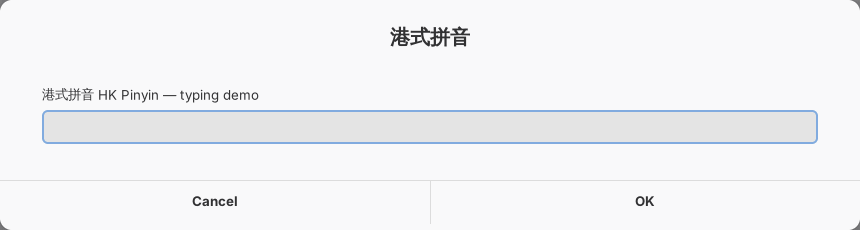
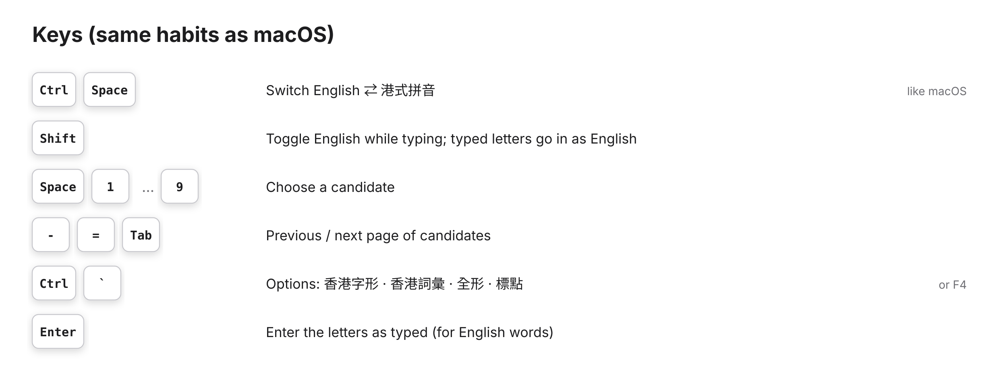
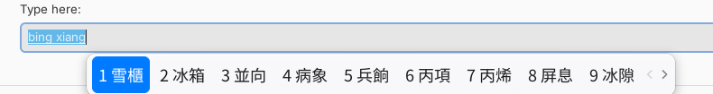
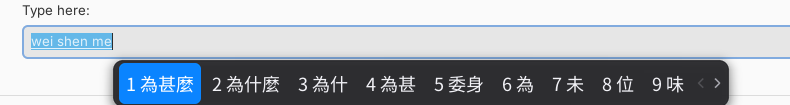
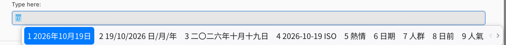
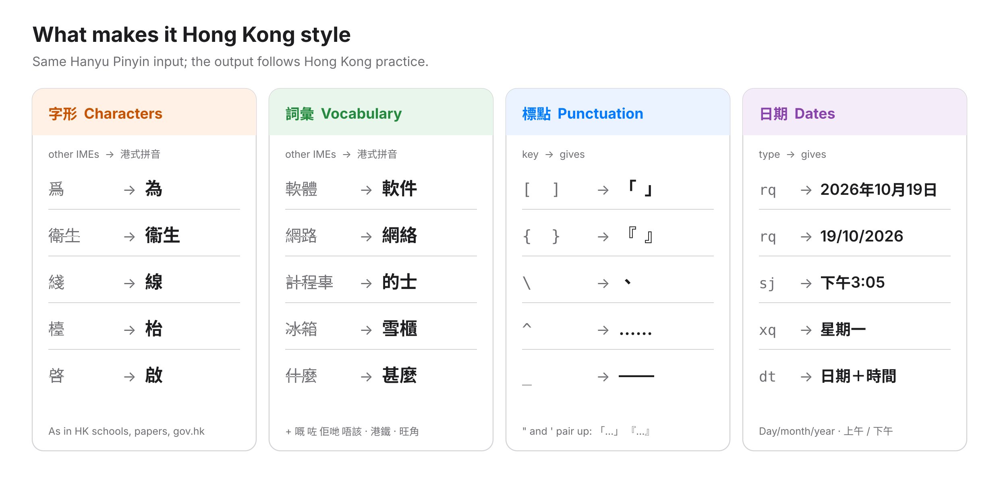
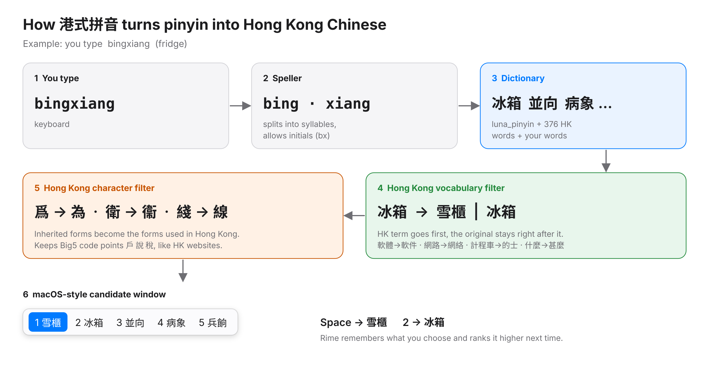

# 港式拼音 HK Pinyin — Guide

A complete guide to installing, using and customising 港式拼音 on Ubuntu.
The same content is available as a [PDF manual](hk-pinyin-manual.pdf).

**Contents**

1. [What it is](#what-it-is)
2. [Install](#install)
3. [Using it](#using-it)
4. [Hong Kong conventions](#hong-kong-conventions)
5. [Customising](#customising)
6. [How it works](#how-it-works)
7. [Development](#development)
8. [Troubleshooting](#troubleshooting)
9. [Uninstall](#uninstall)
10. [Known limits](#known-limits)

---

## What it is

港式拼音 is an input method that behaves like the *Pinyin – Traditional* input source on macOS,
but writes the way Hong Kong writes. You type Hanyu Pinyin without tones; it gives
Traditional Chinese in a single horizontal candidate row.

<p align="center"></p>

| Area | What you get |
|---|---|
| **Input** | Hanyu Pinyin, full syllables or initials (`xg` → 香港), whole-sentence conversion, learns your choices |
| **Characters** | Hong Kong forms 為 衞 線 枱 啟 群 眾, keeping Big5 code points used on HK websites (戶 說 稅) |
| **Vocabulary** | Hong Kong terms first: 軟件 網絡 的士 雪櫃 電郵 甚麼 · 376 built-in HK words, districts and written-Cantonese words |
| **Punctuation** | 「」 『』 、 ， 。 …… —— 《》 on the keys a macOS user expects |
| **Dates** | `rq` 2026年10月19日 · 19/10/2026, `sj` 下午3:05, `xq` 星期一 |
| **Look & keys** | macOS light and dark candidate windows; Ctrl+Space switches; Shift toggles English |

---

## Install

### Requirements

- **Ubuntu 24.04 LTS** (tested) or newer, or Debian 12+.
- Ubuntu 22.04 works with a fallback: without `librime-plugin-lua` you lose the `rq`/`sj` date
  shortcuts, and Hong Kong terms *replace* the original instead of being listed first.
- Any desktop (GNOME, KDE Plasma, Xfce …), X11 or Wayland.
- About 60 MB of packages if fcitx5 is not already installed.

### Steps

```bash
git clone https://github.com/YOUR-USERNAME/hk-pinyin-ime.git
cd hk-pinyin-ime
./install.sh
```

Run it **as yourself**, not with `sudo` — it asks for your password only for `apt`.

The installer:

1. installs fcitx5, fcitx5-rime, the luna_pinyin data, librime-lua and the Noto CJK HK fonts;
2. copies the schema, dictionaries, Lua scripts and OpenCC tables to
   `~/.local/share/fcitx5/rime/` and compiles them;
3. installs the `macos-light` and `macos-dark` themes;
4. configures fcitx5: English + 港式拼音, Ctrl+Space to switch, horizontal candidates,
   Noto Sans CJK HK, input state shared across windows;
5. makes fcitx5 the system input method (`im-config`, `~/.config/environment.d`, autostart).

Any fcitx5 settings it replaces are first copied to
`~/.config/fcitx5/hk-pinyin-backup-<date>/`.

**Then log out and log back in once.**

> **GNOME on Wayland:** install the
> [Input Method Panel (kimpanel)](https://extensions.gnome.org/extension/261/kimpanel/)
> GNOME Shell extension. Without it the candidate window can appear in a corner of the
> screen instead of under the cursor in some apps.

### Installer options

| Option | Meaning |
|---|---|
| `--no-apt` | Don't install packages (you already have fcitx5 and fcitx5-rime) |
| `--layout gb` | Keyboard layout for the English input source. Default: detected, otherwise `us` |
| `--no-config` | Only install the schema and themes; keep your fcitx5 settings. Add 港式拼音 yourself in *Fcitx 5 Configuration* |

---

## Using it

### Keys

<p align="center"></p>

| Key | On Ubuntu | macOS equivalent |
|---|---|---|
| `Ctrl`+`Space` | Switch English ⇄ 港式拼音 | `Ctrl`+`Space` |
| `Shift` | Toggle English inside 港式拼音; letters already typed go in as English | `Caps Lock` / `Shift` |
| `Space`, `1`–`9` | Choose a candidate | same |
| `-` `=` `Tab` | Previous / next page | same |
| `←` `→` | Move through candidates | same |
| `Enter` | Enter the letters as typed | same |
| `Esc` | Cancel | same |
| `Ctrl`+`` ` `` or `F4` | Options menu | — |
| `Shift`+`Space` | Half-width ⇄ full-width | — |
| `Ctrl`+`.` | Chinese ⇄ English punctuation | — |

- Start with a capital letter (`Hello`) to type English without switching.
- Type `/` and a code for symbols: `/fh` © ® ™, `/jt` arrows, `/sx` maths.

### Options menu

`Ctrl`+`` ` `` opens the options. Your choices are remembered.

| Option | On (default) | Off |
|---|---|---|
| 香港詞彙 | 雪櫃 first, 冰箱 second | 冰箱 only |
| 香港字形 | 為 衞 線 | 爲 衛 綫 (Rime's inherited forms) |
| 全形 / 半形 | — | half-width (default) |
| 中文標點 | 「，。」 | ASCII punctuation |

### Screenshots

| | |
|---|---|
|  | Hong Kong term first, mainland/Taiwan word right after: `bingxiang` → 1 雪櫃 2 冰箱 |
|  | Dark theme follows the desktop: `weishenme` → 為甚麼 |


*`rq` gives today's date in Hong Kong formats.*

---

## Hong Kong conventions

<p align="center"></p>

### Characters

Rime's dictionary stores inherited (舊字形) forms. The `hk_glyph` filter changes them to the
forms in everyday Hong Kong use — on government websites, in newspapers, and from Big5/HKSCS
input methods such as 倉頡 and 速成.

| From | 爲 | 衛 | 綫 | 檯 | 啓 | 羣 | 衆 | 裡 | 牀 | 峯 | 敘 | 鉤 | 蔥 | 菸 | 卧 | 麪 |
|---|---|---|---|---|---|---|---|---|---|---|---|---|---|---|---|---|
| **To** | **為** | **衞** | **線** | **枱** | **啟** | **群** | **眾** | **裏** | **床** | **峰** | **敍** | **鈎** | **葱** | **煙** | **臥** | **麵** |

Characters such as 戶 說 稅 脫 溫 are deliberately **not** changed to 户 説 税 脱 温.
Those are the shapes in the 常用字字形表 reference, but Hong Kong text uses the Big5 code points
and lets the HK font draw the local shape. For the strict reference forms, see
[Strict 常用字字形表 forms](#strict-常用字字形表-forms).

### Vocabulary

Hong Kong words are in the dictionary with high weights, and a filter rewrites mainland or
Taiwan terms inside any candidate — word, phrase or sentence — while keeping the original as
the next choice.

| You type | First | Instead of | You type | First | Instead of |
|---|---|---|---|---|---|
| ruanjian | 軟件 | 軟體 | dishi | 的士 | 計程車 |
| wangluo | 網絡 | 網路 | bashi | 巴士 | 公車 |
| dayinji | 打印機 | 印表機 | bingxiang | 雪櫃 | 冰箱 |
| shujuku | 數據庫 | 資料庫 | lianjie | 連結 | 鏈接 |
| dianyou | 電郵 | 電子郵件 | zhuguli | 朱古力 | 巧克力 |
| duanxun | 短訊 | 簡訊 | xuegao | 雪糕 | 冰淇淋 |
| shangzai | 上載 | 上傳 | sanwenzhi | 三文治 | 三明治 |
| shuma | 數碼 | 數位 | danche | 單車 | 腳踏車 |
| rengongzhineng | 人工智能 | 人工智慧 | jiemian | 介面 | 界面 |
| shenme | 甚麼 | 什麼 | anjie | 按揭 | 房貸 |

The built-in list also covers:

- **Government** — 立法會, 廉政公署, 食環署, 入境處, 強積金, 身份證
- **Housing** — 公屋, 居屋, 屋邨, 劏房, 首期
- **Transport** — 港鐵, 八達通, 小巴, 輕鐵, 天星小輪
- **Districts** — about 70, from 旺角 and 尖沙咀 to 鰂魚涌 and 赤鱲角
- **Food** — 茶餐廳, 菠蘿包, 蛋撻, 絲襪奶茶, 魚蛋
- **Written Cantonese** — 嘅 咗 喺 唔 冇 佢 哋 嘢 · 唔該 我哋 而家 點解 搞掂

Cantonese characters use a sensible Mandarin reading: 佢 `qu`, 嘅 `ge`, 冇 `mao`, 喺 `xi`,
嘢 `ye`, 哋 `di`.

Where a Hong Kong word shares its pinyin with a very common word, the common word stays first
(`zhishi` → 只是, then 芝士). After you choose 芝士 a few times, it moves up for you.

The full list is in [`tools/hk_terms.src`](../tools/hk_terms.src) (dictionary words) and
[`rime/opencc/hk_terms.txt`](../rime/opencc/hk_terms.txt) (term replacements).

### Punctuation

| Key | Gives | Key | Gives | Key | Gives | Key | Gives |
|---|---|---|---|---|---|---|---|
| `,` | ， | `[` | 「 | `"` | 「 then 」 | `\` | 、 |
| `.` | 。 | `]` | 」 | `'` | 『 then 』 | `^` | …… |
| `?` | ？ | `{` | 『 | `<` | 《 〈 « | `_` | —— |
| `!` | ！ | `}` | 』 | `>` | 》 〉 » | `$` | $ HK$ ¥ € £ |
| `;` | ； | `(` | （ | `:` | ： | `*` | * × ※ |

Keys with several choices (`<`, `$`, `*`) show a small menu; press the key again or a number.

### Dates and times

| Type | Candidates |
|---|---|
| `rq` | 2026年10月19日 · 19/10/2026 · 二〇二六年十月十九日 · 2026-10-19 |
| `sj` | 下午3:05 · 15:05 · 下午三時零五分 (三時正 on the hour) |
| `xq` | 星期一 · 週一 · （一） |
| `dt` | 2026年10月19日（星期一）下午3:05 · 19/10/2026 15:05 |

Numeric dates are day/month/year, as in Hong Kong. Periods are 凌晨, 上午, 下午, 晚上.

---

## Customising

Everything lives in `~/.local/share/fcitx5/rime/`. After a change, choose **Deploy** (重新部署)
in the fcitx5 tray menu, or run `fcitx5 -r`.

Reinstalling never overwrites your own files:

- `hk_pinyin.user_terms.dict.yaml` — your words
- `hk_pinyin.custom.yaml` — your settings (only on systems without librime-lua does the
  installer write it, after making a backup)

### Add your own words

Edit `hk_pinyin.user_terms.dict.yaml`. Below the `...` line, one word per line, fields
separated by **Tab** characters: word, pinyin, weight.

```
長洲太平清醮	chang zhou tai ping qing jiao	50000
將軍澳中心	jiang jun ao zhong xin	50000
```

Write ü as `v` (`lv` 律, `nv` 女). A weight of 50000 puts a word ahead of most homophones.

### Common changes

Create `hk_pinyin.custom.yaml`:

```yaml
patch:
  # fewer candidates per page
  menu/page_size: 6

  # fuzzy pinyin: z=zh c=ch s=sh, an=ang en=eng in=ing
  speller/algebra/+:
    - derive/^([zcs])h/$1/
    - derive/^([zcs])([^h])/$1h$2/
    - derive/([aei])n$/$1ng/
    - derive/([aei])ng$/$1n/

  # start each window in English instead of Chinese
  switches/@0/reset: 1
```

### Strict 常用字字形表 forms

To get 户 説 税 温 and the other reference shapes, copy OpenCC's `t2hk` tables and point the
character filter at them:

```bash
cp /usr/share/opencc/t2hk.json /usr/share/opencc/HKVariants.ocd2 \
   ~/.local/share/fcitx5/rime/opencc/
```

```yaml
# hk_pinyin.custom.yaml
patch:
  hk_glyph/opencc_config: t2hk.json
```

### Window style

*Fcitx 5 Configuration* → *Addons* → *Classic User Interface*: choose `macos-light` /
`macos-dark`, the font, or a vertical list.

To change colours, edit `THEMES` in [`tools/make_themes.py`](../tools/make_themes.py), run it,
then `./install.sh --no-apt`.

---

## How it works

<p align="center"></p>

There is no new C code in the typing path. 港式拼音 is a Rime *schema* running inside fcitx5,
so it gets fcitx5's support for GTK, Qt, X11 and Wayland applications.

| Stage | File | What it does |
|---|---|---|
| Speller | `rime/hk_pinyin.schema.yaml` | Splits `bingxiang` into `bing xiang`; abbreviations and typo correction |
| Dictionary | `rime/hk_pinyin.dict.yaml` | luna_pinyin + `hk_pinyin.hk_terms` + `hk_pinyin.user_terms` |
| Dates | `rime/lua/hk_datetime.lua` | `rq` `sj` `xq` `dt` |
| Vocabulary filter | `rime/lua/hk_terms_filter.lua` + `rime/opencc/hk_terms.txt` | 冰箱 → 雪櫃, original kept as next candidate |
| Character filter | `rime/opencc/hk_glyph.txt` | 爲 → 為, 衛 → 衞 … |
| Punctuation, keys | `rime/hk_pinyin.schema.yaml`, `rime/default.custom.yaml` | 「」、…… ; Shift toggle; paging |
| Window | `themes/macos-*` | fcitx5 classic UI themes |

---

## Development

### Repository layout

| Path | Purpose |
|---|---|
| `install.sh`, `uninstall.sh` | Installer and remover |
| `rime/hk_pinyin.schema.yaml` | The schema: switches, engine pipeline, punctuation, keys |
| `rime/hk_pinyin.dict.yaml` | Main dictionary: imports luna_pinyin + HK terms + user terms |
| `rime/hk_pinyin.hk_terms.dict.yaml` | HK words (**generated** — edit `tools/hk_terms.src`) |
| `rime/hk_pinyin.user_terms.dict.yaml` | Template for the user's words |
| `rime/default.custom.yaml` | Global Rime settings: page size, Shift behaviour, menu keys |
| `rime/lua/` | Date/time translator and HK vocabulary filter |
| `rime/opencc/` | Term and character conversion tables |
| `themes/` | fcitx5 themes (**generated** by `tools/make_themes.py`) |
| `tools/hk_terms.src` | Source of the HK word list |
| `tools/build_dict.py` | Builds the HK dictionary; checks syllable counts |
| `tools/make_themes.py` | Draws theme images, writes `theme.conf` |
| `tools/make_readme_images.py` | Draws the explanation images |
| `tests/rime_probe.c`, `tests/run_tests.sh` | Types pinyin into librime and checks expected output |
| `docs/` | This guide, the PDF manual and its LaTeX source, images |

### Loop

```bash
sudo apt install gcc librime-dev librime-plugin-lua rime-data-luna-pinyin python3-pil
$EDITOR tools/hk_terms.src         # add words:  詞語 | pin yin | weight
python3 tools/build_dict.py        # regenerate the dictionary
tests/run_tests.sh                 # 26 checks, no desktop needed
./install.sh --no-apt              # try it for real
```

To try one word quickly without installing:

```bash
gcc -o /tmp/probe tests/rime_probe.c $(pkg-config --cflags --libs rime)
mkdir -p /tmp/hkp && cp -r rime/. /tmp/hkp/
/tmp/probe /tmp/hkp /usr/share/rime-data bingxiang rq "!hk_terms" bingxiang
```

### Rebuilding docs and images

```bash
python3 tools/make_readme_images.py         # needs librsvg2-bin, fonts-inter, fonts-noto-cjk
cd docs && xelatex hk-pinyin-manual.tex && xelatex hk-pinyin-manual.tex   # needs texlive-xetex texlive-lang-chinese
```

---

## Troubleshooting

| Problem | Fix |
|---|---|
| Ctrl+Space does nothing | Log out and in after installing. Check `im-config -m` shows `fcitx5` and `pgrep fcitx5` finds it running |
| Works in some apps, not others | Install `fcitx5-frontend-gtk4` / `fcitx5-frontend-qt6`. For Flatpak apps: `flatpak override --user --env=GTK_IM_MODULE=fcitx` |
| Candidate window in a screen corner (GNOME Wayland) | Install the kimpanel GNOME extension |
| Chromium / Electron apps on Wayland | Start with `--enable-wayland-ime`, or run them under XWayland |
| No `rq` dates; terms replaced instead of listed | `librime-plugin-lua` is missing — install it, then `./install.sh --no-apt` |
| Word list changes have no effect | Tray menu → **Deploy**, or `fcitx5 -r`. Check `/tmp/hk-pinyin-deploy.log` |
| A wrong word keeps coming first | Choose the right one a few times; Rime learns. To forget learned words: `./uninstall.sh --purge`, then reinstall |

---

## Uninstall

```bash
./uninstall.sh          # remove schema and themes, keep learned words
./uninstall.sh --purge  # also delete learned words and your word list
im-config -n ibus       # optional: go back to IBus
```

fcitx5 itself stays installed; remove it with `sudo apt remove fcitx5 fcitx5-rime` if wanted.

---

## Known limits

- **Caps Lock** types capital letters; it does not switch input sources as on macOS. Use **Shift**.
- No cloud or AI prediction — conversion uses Rime's statistical model and your history.
- How the unconverted pinyin looks inside the text field (underlined or highlighted) depends on
  the application.
- Written-Cantonese characters use approximate Mandarin readings, not Jyutping. For full
  Cantonese input, add Rime's `jyut6ping3` schema alongside.
- Tested with Ubuntu 24.04, fcitx5 5.1.7, librime 1.10, librime-lua 2023-09.
